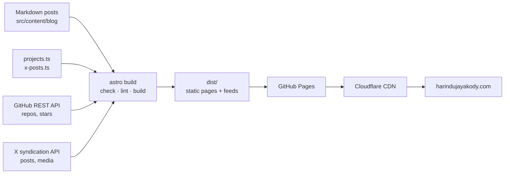

<div align="center">

# harindujayakody.com

**Personal site, blog and project portfolio of [Harindu Jayakody](https://harindujayakody.com), founder of [Infiax](https://infiax.com).**

A static Astro site that ships almost no JavaScript, pulls its data from GitHub and X at build time, and deploys to GitHub Pages on every push.

[](https://github.com/harindujayakody/harindujayakody.github.io/actions/workflows/deploy.yml)
[](https://github.com/harindujayakody/harindujayakody.github.io/actions/workflows/ci.yml)
[](CHANGELOG.md)
[](https://harindujayakody.com)
[](LICENSE)

[](https://astro.build)
[](https://tailwindcss.com)
[](https://www.typescriptlang.org)
[](https://nodejs.org)
[](https://pages.github.com)
[](https://www.cloudflare.com)

[Live site](https://harindujayakody.com) · [Blog](https://harindujayakody.com/blog/) · [Projects](https://harindujayakody.com/projects/) · [Changelog](CHANGELOG.md)

</div>

---

## Contents

- [Highlights](#highlights)
- [Tech stack](#tech-stack)
- [How it works](#how-it-works)
- [Project structure](#project-structure)
- [Getting started](#getting-started)
- [Publishing content](#publishing-content)
- [Quality, CI and security](#quality-ci-and-security)
- [SEO and AI-agent support](#seo-and-ai-agent-support)
- [Performance](#performance)
- [Documentation](#documentation)
- [License](#license)

## Highlights

| | |
|---|---|
| **Blog** | Markdown posts with categories (indexable) and tags, 16:9 cover and inline images, related posts, multi-part series, older/newer links, reading progress bar, reading time and RSS |
| **Fast navigation** | Pages prerender on hover (Speculation Rules) and cross-fade with View Transitions; both need no JavaScript and fall back to normal links |
| **Projects & Tools** | Hand-picked tools and projects plus every public GitHub repo, sorted by stars |
| **Repo timeline** | Every public repository grouped by year, refreshed daily from the GitHub API |
| **Contribution graph** | The last year of GitHub activity on the home page, built at build time in the site's mint, no JavaScript |
| **X posts** | Home-page feed and in-article embeds rendered as site-themed cards at build time, with no X script on the page |
| **Code blocks** | GitHub dark syntax theme with a copy button |
| **Search** | `Ctrl/⌘ + K` or `/` opens a search pop-up anywhere: grouped, highlighted results with full keyboard control. `/search/?q=` page for shareable links |
| **Keyboard shortcuts** | `g` then `h`/`b`/`p`/`t` to jump between sections, `?` for the shortcuts list |
| **SEO** | Canonical URLs, Open Graph, JSON-LD structured data, sitemap, robots.txt |
| **Social cards** | A 1200×630 share image generated for every post (title, category, date, avatar) so links get large previews |
| **AI agents** | `llms.txt`, `llms-full.txt` and a plain-markdown copy of every post |
| **Design** | Dark terminal-flavoured theme on shadcn/ui tokens, CSS-only motion that respects reduced-motion |

## Tech stack

| Layer | Technology | Why |
|---|---|---|
| Framework | [Astro 7](https://astro.build) (static output) | HTML-first, zero JS by default, typed content collections |
| Markdown | Sätteri processor + a custom hast plugin | Astro 7's default Markdown engine; the plugin turns X embed code into static cards |
| Styling | [Tailwind CSS 4](https://tailwindcss.com) via `@tailwindcss/vite` | Utility CSS, inlined into each page so there's no render-blocking stylesheet |
| Components | Astro components using [shadcn/ui](https://ui.shadcn.com) token names | shadcn's look and theming model without shipping React |
| Typography | Poppins (headings), Inter (body), JetBrains Mono (numbers and code) via Fontsource | Self-hosted, so no third-party font requests; above-the-fold fonts preloaded |
| Images | `astro:assets` | Responsive WebP with `srcset`, social-card images generated at build |
| Social cards | [satori](https://github.com/vercel/satori) + [resvg-js](https://github.com/thx/resvg-js) | Build-time 1200×630 PNGs in the site style; no runtime service, nothing shipped to visitors |
| Syntax highlighting | Shiki, `github-dark-default` | Same colours as GitHub dark mode, rendered at build time |
| Language | TypeScript (strict) | Typed props, content schema (Zod) and data helpers |
| Quality | `astro check`, ESLint | Type checking and linting gate every deploy and pull request |
| CI/CD | GitHub Actions (SHA-pinned) | Build, check, lint and deploy; daily scheduled rebuild |
| Hosting | GitHub Pages behind Cloudflare | Free static hosting with a global CDN on the custom domain |

## How it works

Everything is rendered at **build time**. The browser receives HTML, inlined CSS, fonts and images.



1. **Content.** Posts are Markdown files validated by a Zod schema (`src/content.config.ts`): title, dates, category, tags, cover image, draft flag. Drafts appear in `npm run dev` but never in production.
2. **Live data, fetched once per build.** The GitHub API supplies repos and stars for the timeline, stats and projects page. X's public syndication endpoint (no API key) supplies posts for the home feed and article embeds. Both fail soft: a failed request skips that item and the build still succeeds.
3. **X embeds without X's script.** Pasted X embed code is swapped at build time by a Sätteri hast plugin (`src/lib/x-embed-plugin.ts`) for the same card used on the home page (`xCardHtml` in `src/lib/x.ts`): author, verified badge, text, a photo or video preview and like/reply counts.
4. **Generated endpoints.** `sitemap.xml`, `robots.txt`, `rss.xml`, `search.json`, `llms.txt`, `llms-full.txt` and `/blog/<slug>.md` are plain Astro endpoints with no extra dependencies.
5. **Deploy.** Every push to `master`, plus a daily 01:00 UTC schedule, runs `check → lint → test → build` and publishes `dist/` to GitHub Pages. The daily run keeps repo stats and X counts fresh without commits.

**Client-side JavaScript** is small and deferred: keyboard shortcuts (~1 KB, inline), the search pop-up (~1.3 KB gzipped, which fetches the search index only when first opened), and the copy buttons, which only ship on posts that contain code.

## Project structure

```text
.
├── .github/workflows/
│   ├── ci.yml              # check, lint, test, build on every pull request
│   └── deploy.yml          # check, lint, test, build, deploy to Pages (push + daily)
├── docs/                   # ARCHITECTURE, DESIGN, CONTENT guides
├── public/                 # avatar.png, favicon.jpg (fixed URLs)
├── src/
│   ├── assets/             # images optimized by astro:assets
│   ├── components/         # PostList, Timeline, ProjectCard, XFeed, BlogIndex, ui/*
│   ├── content/blog/       # Markdown posts + images/
│   ├── data/               # projects.ts, x-posts.ts (hand-edited lists)
│   ├── layouts/Layout.astro# <head> SEO, nav, footer
│   ├── lib/                # posts, github, x, x-embed-plugin helpers
│   ├── pages/              # routes and generated endpoints
│   ├── styles/global.css   # tokens, base styles, motion, prose
│   └── content.config.ts   # blog schema
├── astro.config.mjs
├── eslint.config.mjs
└── package.json
```

## Getting started

**Requirements:** Node.js 22 or newer (CI uses 24) and npm.

```bash
git clone https://github.com/harindujayakody/harindujayakody.github.io.git
cd harindujayakody.github.io
npm ci
npm run dev        # http://localhost:4321
```

| Script | What it does |
|---|---|
| `npm run dev` | Dev server with hot reload; shows drafts |
| `npm run build` | Production build to `dist/` |
| `npm run preview` | Serve the production build locally |
| `npm run check` | Type-check `.astro` and `.ts` files (`astro check`) |
| `npm run lint` | Lint with ESLint |
| `npm test` | Unit tests for the search logic (`src/lib/search.test.mjs`) |

Set `GITHUB_TOKEN` in your shell if you hit GitHub's anonymous API limit (60 requests an hour). It's also needed for the contribution graph, because GitHub's GraphQL API doesn't allow anonymous requests; without it the graph is simply left out. With the GitHub CLI: `GITHUB_TOKEN=$(gh auth token) npm run build`. CI provides it automatically.

## Publishing content

| Task | How |
|---|---|
| Write a post | Add `src/content/blog/<slug>.md` and push. Start from [`sample-post.md`](src/content/blog/sample-post.md), which uses every feature |
| Add a cover image | Put it in `src/content/blog/images/` and set `image: ./images/<file>` (16:9) |
| Embed an X post | Paste X's embed `<blockquote>` (without the `<script>` line) |
| Feature X posts on the home page | Add URLs to `src/data/x-posts.ts` |
| Add a tool or project | Add an entry to `src/data/projects.ts` |

Full front-matter reference: [docs/CONTENT.md](docs/CONTENT.md).

## Quality, CI and security

- **Gated deploys.** `deploy.yml` runs `astro check` and ESLint before building; a type or lint error stops the release.
- **Pull-request checks.** `ci.yml` runs the same check, lint, tests and build on every pull request, so problems show before merging.
- **Pinned actions.** Every GitHub Action is pinned to a full commit SHA, with the matching release in a comment, so a moved tag can't change what runs.
- **Least-privilege tokens.** Workflows request only `contents: read` (plus `pages` and `id-token` for deploying).
- **Reproducible installs.** `npm ci` from the committed lockfile.
- **No secrets in the repo.** The only token used is GitHub's built-in `GITHUB_TOKEN`.

## SEO and AI-agent support

- One canonical URL per page; Open Graph and Twitter cards with large-image previews, using a generated card per post (`/og/<slug>.png`, with width, height and alt declared).
- JSON-LD structured data: `ProfilePage` and `Person`, `WebSite` with `SearchAction`, `BlogPosting`, `BreadcrumbList`, `CollectionPage`.
- `sitemap.xml` with `lastmod`, `robots.txt` and an RSS 2.0 feed.
- Category pages are indexable; tag pages and search are `noindex, follow` so they don't compete with categories.
- [`/llms.txt`](https://harindujayakody.com/llms.txt) (per [llmstxt.org](https://llmstxt.org)), [`/llms-full.txt`](https://harindujayakody.com/llms-full.txt), and a raw Markdown copy of each post at `/blog/<slug>.md`.

## Performance

- Static HTML with CSS inlined into each page: no render-blocking stylesheet request.
- Self-hosted fonts, with the two above-the-fold faces preloaded.
- Images served as responsive WebP with explicit dimensions (no layout shift); X media loads as X's 680px JPG.
- No framework runtime and no third-party scripts from the site itself.
- Long-term caching of hashed `/_astro/*` assets is configured at the CDN (see [docs/ARCHITECTURE.md](docs/ARCHITECTURE.md#cloudflare-in-front-of-harindujayakodycom)).

## Documentation

| Document | Contents |
|---|---|
| [docs/ARCHITECTURE.md](docs/ARCHITECTURE.md) | Build pipeline, routes, data sources and failure modes, deploy, SEO model |
| [docs/DESIGN.md](docs/DESIGN.md) | Colour tokens, typography, motion, components, accessibility |
| [docs/CONTENT.md](docs/CONTENT.md) | Writing posts, front matter, images, embeds, projects |
| [CHANGELOG.md](CHANGELOG.md) | Release history ([Keep a Changelog](https://keepachangelog.com), SemVer) |

## License

[MIT](LICENSE). The code is free to reuse. Blog posts and personal content remain © Harindu Jayakody.
