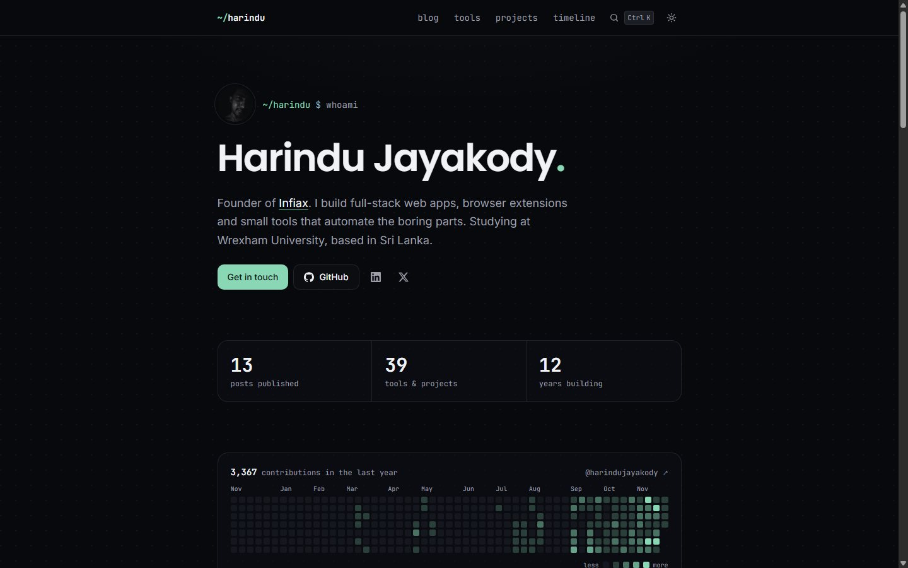
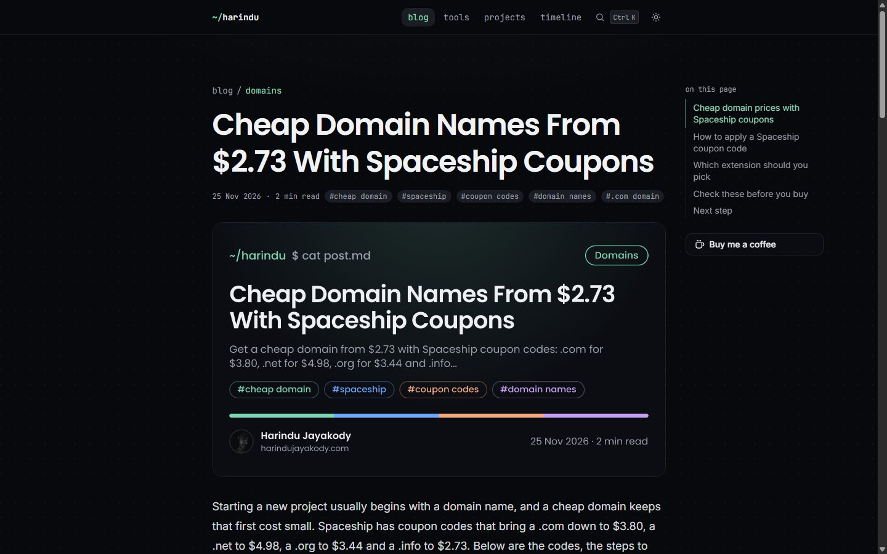
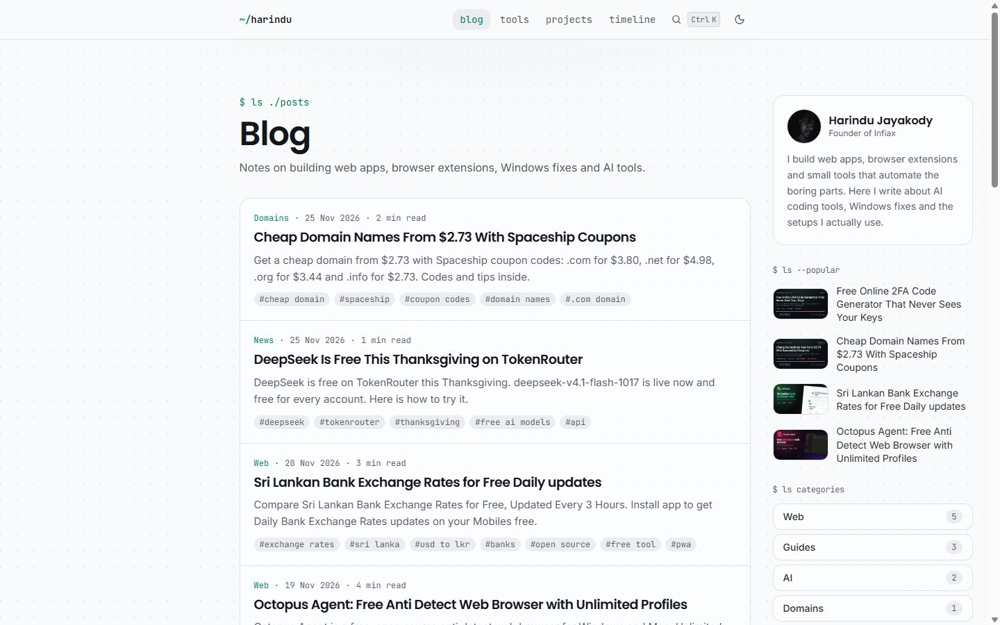
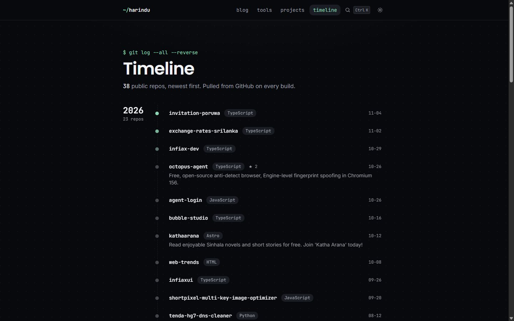
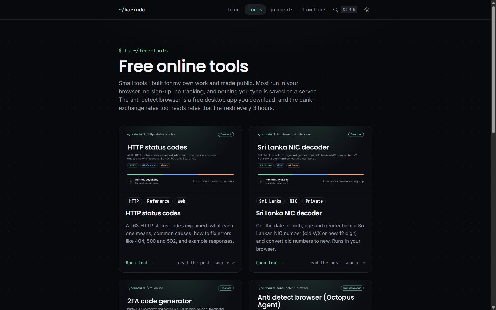
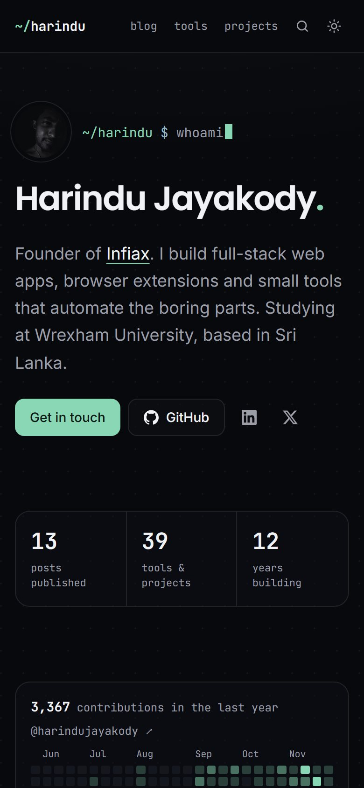
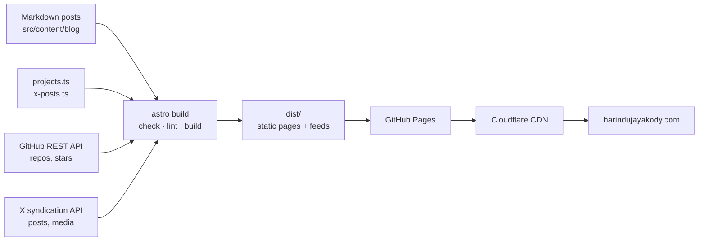

<div align="center">

<a href="https://harindujayakody.com">
  
</a>

# harindujayakody.com

Personal site, blog and project portfolio of [Harindu Jayakody](https://harindujayakody.com), founder of [Infiax](https://infiax.com).<br>
A static Astro site that ships almost no JavaScript, pulls its data from GitHub and X at build time, and deploys to GitHub Pages on every push.

[](https://github.com/harindujayakody/harindujayakody.github.io/actions/workflows/deploy.yml)
[](https://github.com/harindujayakody/harindujayakody.github.io/actions/workflows/ci.yml)
[](CHANGELOG.md)
[](https://harindujayakody.com)
[](LICENSE)

[](https://astro.build)
[](https://tailwindcss.com)
[](https://www.typescriptlang.org)
[](https://nodejs.org)
[](https://pages.github.com)
[](https://www.cloudflare.com)

[Live site](https://harindujayakody.com) · [Blog](https://harindujayakody.com/blog/) · [Projects](https://harindujayakody.com/projects/) · [Free tools](https://harindujayakody.com/free-tools/) · [Changelog](CHANGELOG.md)

</div>

## Contents

- [Screenshots](#screenshots)
- [Highlights](#highlights)
- [Tech stack](#tech-stack)
- [How it works](#how-it-works)
- [Project structure](#project-structure)
- [Getting started](#getting-started)
- [Publishing content](#publishing-content)
- [Quality, CI and security](#quality-ci-and-security)
- [SEO and AI-agent support](#seo-and-ai-agent-support)
- [Performance](#performance)
- [Documentation](#documentation)
- [License](#license)

## Screenshots

<table>
  <tr>
    <td width="50%"><br><sub>Blog post with its generated cover card and table of contents</sub></td>
    <td width="50%"><br><sub>Blog index in light mode, which is the default</sub></td>
  </tr>
  <tr>
    <td width="50%"><br><sub>Repo timeline, refreshed from the GitHub API every day</sub></td>
    <td width="50%"><br><sub>Free browser tools</sub></td>
  </tr>
</table>

<p align="center">
  
</p>

## Highlights

Blog

- Markdown posts with indexable categories, tags, a 16:9 cover, inline images, related posts, multi-part series, older and newer links, a reading progress bar, reading time, an "updated" date and RSS.
- Screens 1400px and wider get a sticky sidebar (about, popular posts with thumbnails, categories with counts). Posts get a sticky table of contents that follows the section you are reading.
- Hover or focus a link to this site, GitHub or kathaarana.com and a small card shows its image, title and description, read at build time.
- Every post ends with a Yes/No "Was this helpful?" box. Yes votes are counted by a small Cloudflare Worker (`worker/`, KV storage, one vote per visitor per post, no login), and the footer lists the top posts.
- Comments run through giscus (GitHub Discussions), in the site's colours. They load only when you scroll to them, and `comments: false` turns them off per post.
- A Buttondown sign-up form follows every post and sits on the blog pages. It is a plain form with no JavaScript or tracking script.
- Code blocks use the GitHub dark theme and have a copy button.

Pages

- The home page has a feed of X posts and the last year of GitHub activity as a contribution graph in the site's mint, both drawn at build time without JavaScript. X posts embedded in articles use the same cards, with no X script on the page.
- Projects lists hand-picked work plus every public GitHub repo, sorted by stars. The timeline groups every public repo by year and refreshes daily.
- Free tools live under `/free-tools/`:
  - an HTTP status codes reference, with a hub and a page for each of the 63 codes;
  - a 2FA (TOTP) code generator that sends and saves nothing;
  - a Sri Lanka NIC decoder (birthday, age, gender, old and new format), which can also be embedded in posts;
  - a landing page for the Octopus Agent anti detect browser, with Windows and Mac downloads that follow the newest GitHub release;
  - a Sri Lankan bank exchange rates tool that runs on the page itself (`components/RatesApp.astro`). It shows the best bank per currency, a buying and selling toggle, a history chart, a ranked bank table and the daily best and worst. It is also an installable app (manifest in `public/lkr/`, service worker at `public/free-tools/exchange-rates/sw.js`) and reads small JSON files that a script on the author's PC refreshes every 3 hours (`src/data/rates.ts` holds the data address).
- Each tool is a card with its own share image, and "Star on GitHub" cards show live star counts.

Navigation and feel

- Pages prerender on hover (Speculation Rules) and cross-fade with View Transitions. Neither needs JavaScript, and both fall back to normal links.
- `Ctrl/⌘ + K` or `/` opens a search pop-up anywhere, with grouped, highlighted results and full keyboard control. `/search/?q=` gives shareable links.
- `g` then `h`, `b`, `p` or `t` jumps between sections, and `?` lists the shortcuts.
- The site is light by default with a dark switch: the old page shrinks into the toggle going dark, and a hole opens out of it going light. The header is solid and the style is terminal-flavoured, built on shadcn/ui tokens, with CSS-only motion that respects reduced motion.

Discovery

- Canonical URLs, Open Graph, JSON-LD structured data, a sitemap and `robots.txt`.
- A GitHub-style 1200×630 card is generated for every post and tool (title, description, tag pills, a colour bar with one slice per tag, avatar). It is the share image, and the featured image for posts without a cover.
- `llms.txt`, `llms-full.txt` and a plain Markdown copy of every post for AI agents.
- A Ko-fi button sits in the blog sidebars and the tools footer, and `.github/FUNDING.yml` lists GitHub Sponsors and Ko-fi.

## Tech stack

| Layer | Technology | Why |
|---|---|---|
| Framework | [Astro 7](https://astro.build) (static output) | HTML-first, zero JS by default, typed content collections |
| Markdown | Sätteri processor + a custom hast plugin | Astro 7's default Markdown engine; the plugin turns X embed code into static cards |
| Styling | [Tailwind CSS 4](https://tailwindcss.com) via `@tailwindcss/vite` | Utility CSS, inlined into each page so there's no render-blocking stylesheet |
| Components | Astro components using [shadcn/ui](https://ui.shadcn.com) token names | shadcn's look and theming model without shipping React |
| Typography | Poppins (headings), Inter (body), Noto Sans Sinhala (Sinhala script), JetBrains Mono (numbers and code) via Fontsource | Self-hosted, so no third-party font requests; above-the-fold fonts preloaded; the Sinhala file loads only on pages that use it |
| Images | `astro:assets` | Responsive WebP with `srcset`, social-card images generated at build |
| Social cards | [satori](https://github.com/vercel/satori) + [resvg-js](https://github.com/thx/resvg-js) | Build-time 1200×630 PNGs in the site style; no runtime service, nothing shipped to visitors |
| Syntax highlighting | Shiki, `github-dark-default` | Same colours as GitHub dark mode, rendered at build time |
| Language | TypeScript (strict) | Typed props, content schema (Zod) and data helpers |
| Quality | `astro check`, ESLint | Type checking and linting gate every deploy and pull request |
| CI/CD | GitHub Actions (SHA-pinned) | Build, check, lint and deploy; daily scheduled rebuild |
| Hosting | GitHub Pages behind Cloudflare | Free static hosting with a global CDN on the custom domain |
| Votes API | Cloudflare Worker + KV (`worker/`) | The only server-side piece: counts "Was this helpful?" votes. Deployed separately with `npx wrangler deploy` |

## How it works

Everything is rendered at build time. The browser receives HTML, inlined CSS, fonts and images.



1. Posts are Markdown files validated by a Zod schema (`src/content.config.ts`): title, dates, category, tags, cover image, draft flag. Drafts appear in `npm run dev` but never in production.
2. The GitHub API supplies repos and stars for the timeline, stats and projects page. X's public syndication endpoint (no API key) supplies posts for the home feed and article embeds. Both fail soft: a failed request skips that item and the build still succeeds.
3. Pasted X embed code is swapped at build time by a Sätteri hast plugin (`src/lib/x-embed-plugin.ts`) for the same card used on the home page (`xCardHtml` in `src/lib/x.ts`): author, verified badge, text, a photo or video preview and like/reply counts.
4. `lib/link-meta.ts` reads the title, description and image of links to GitHub, kathaarana.com and harindujayakody.com at build time (only those hosts, 8 s timeout, a failed page just gets no preview). Internal links use the post and tool data directly.
5. `sitemap.xml`, `robots.txt`, `rss.xml`, `search.json`, `llms.txt`, `llms-full.txt` and `/blog/<slug>.md` are plain Astro endpoints with no extra dependencies.
6. Every push to `master`, plus a daily 01:00 UTC schedule, runs `check → lint → test → build` and publishes `dist/` to GitHub Pages. The daily run keeps repo stats and X counts fresh without commits.

Client-side JavaScript is small and deferred: keyboard shortcuts (~1 KB, inline), the search pop-up (~1.3 KB gzipped, which fetches the search index only when first opened), the theme switch, the table of contents highlight, link previews and copy buttons (each only on pages that need them), and the vote box and footer popular list, which call the votes Worker. If the Worker is unreachable those parts hide themselves.

## Project structure

```text
.
├── .github/workflows/
│   ├── ci.yml              # check, lint, test, build on every pull request
│   └── deploy.yml          # check, lint, test, build, deploy to Pages (push + daily)
├── docs/                   # ARCHITECTURE, DESIGN, CONTENT guides
├── worker/                 # Cloudflare Worker for helpful votes (index.js, wrangler.jsonc)
├── public/                 # avatar.png, favicon.jpg (fixed URLs)
├── src/
│   ├── assets/             # images optimized by astro:assets
│   ├── components/         # PostList, BlogIndex, BlogSidebar, TocSidebar, HelpfulVote, Kofi, Timeline, ProjectCard, XFeed, ui/*
│   ├── content/blog/       # Markdown posts + images/
│   ├── data/               # projects.ts, x-posts.ts, free-tools.ts, votes.ts (hand-edited lists)
│   ├── layouts/Layout.astro# <head> SEO, nav, footer
│   ├── lib/                # posts, github, x, x-embed-plugin, link-meta helpers
│   ├── pages/              # routes and generated endpoints
│   ├── styles/global.css   # tokens, base styles, motion, prose
│   └── content.config.ts   # blog schema
├── astro.config.mjs
├── eslint.config.mjs
└── package.json
```

## Getting started

Requirements: Node.js 22 or newer (CI uses 24) and npm.

```bash
git clone https://github.com/harindujayakody/harindujayakody.github.io.git
cd harindujayakody.github.io
npm ci
npm run dev        # http://localhost:4321
```

| Script | What it does |
|---|---|
| `npm run dev` | Dev server with hot reload; shows drafts |
| `npm run build` | Production build to `dist/` |
| `npm run preview` | Serve the production build locally |
| `npm run check` | Type-check `.astro` and `.ts` files (`astro check`) |
| `npm run lint` | Lint with ESLint |
| `npm test` | Unit tests: search logic, TOTP (RFC 6238 test vectors) and the NIC decoder |

Set `GITHUB_TOKEN` in your shell if you hit GitHub's anonymous API limit (60 requests an hour). It's also needed for the contribution graph, because GitHub's GraphQL API doesn't allow anonymous requests; without it the graph is simply left out. CI provides it automatically. Locally, with the GitHub CLI:

```bash
# Bash / Git Bash / macOS / Linux
GITHUB_TOKEN=$(gh auth token) npm run build
```

```powershell
# Windows PowerShell (stays set for this terminal; remove with: Remove-Item Env:GITHUB_TOKEN)
$env:GITHUB_TOKEN = gh auth token
npm run build
```

## Publishing content

| Task | How |
|---|---|
| Write a post | Add `src/content/blog/<slug>.md` and push. Start from [`sample-post.md`](src/content/blog/sample-post.md), which uses every feature |
| Add a cover image | Put it in `src/content/blog/images/` and set `image: ./images/<file>` (16:9) |
| Embed an X post | Paste X's embed `<blockquote>` (without the `<script>` line) |
| Feature X posts on the home page | Add URLs to `src/data/x-posts.ts` |
| Add a tool or project | Add an entry to `src/data/projects.ts` |
| Add a free tool | Add a page under `src/pages/free-tools/` and an entry in `src/data/free-tools.ts` (it gets a card, sitemap entry and share image) |
| Mark a post popular | `popular: true` in its front matter (shown in the blog sidebar; votes re-rank it) |
| Two posts on one day | Give `date` a time, e.g. `2026-11-20T14:30:00+05:30`, so the newer one lists first |

Full front-matter reference: [docs/CONTENT.md](docs/CONTENT.md).

## Quality, CI and security

- `deploy.yml` runs `astro check` and ESLint before building; a type or lint error stops the release.
- `ci.yml` runs the same check, lint, tests and build on every pull request, so problems show before merging.
- Every GitHub Action is pinned to a full commit SHA, with the matching release in a comment, so a moved tag can't change what runs.
- Workflows request only `contents: read` (plus `pages` and `id-token` for deploying).
- `npm ci` from the committed lockfile.
- The only token used is GitHub's built-in `GITHUB_TOKEN`. The votes Worker only accepts requests from this site and `localhost:4321`, validates post ids and stores a hash of the visitor, not the IP.
- Cloudflare Web Analytics, added by Cloudflare at the edge (not in the code); no cookies, so no consent banner. See [docs/ARCHITECTURE.md](docs/ARCHITECTURE.md#cloudflare-in-front-of-harindujayakodycom).

## SEO and AI-agent support

- One canonical URL per page; Open Graph and Twitter cards with large-image previews, using a generated card per post and tool (`/og/<slug>.png`, with width, height and alt declared).
- JSON-LD structured data: `ProfilePage` and `Person`, `WebSite` with `SearchAction`, `BlogPosting` (with `dateModified`), `BreadcrumbList`, `CollectionPage`, plus `WebApplication`, `SoftwareApplication` and `FAQPage` on tool pages.
- `sitemap.xml` with `lastmod`, `robots.txt` and an RSS 2.0 feed.
- Category pages are indexable; tag pages and search are `noindex, follow` so they don't compete with categories.
- [`/llms.txt`](https://harindujayakody.com/llms.txt) (per [llmstxt.org](https://llmstxt.org)), [`/llms-full.txt`](https://harindujayakody.com/llms-full.txt), and a raw Markdown copy of each post at `/blog/<slug>.md`.

## Performance

- Static HTML with CSS inlined into each page: no render-blocking stylesheet request.
- Self-hosted fonts, with the two above-the-fold faces preloaded; Sinhala text uses its own font file only where needed.
- Images served as responsive WebP with explicit dimensions (no layout shift); X media loads as X's 680px JPG.
- No framework runtime and no third-party scripts from the site itself.
- Long-term caching of hashed `/_astro/*` assets is configured at the CDN (see [docs/ARCHITECTURE.md](docs/ARCHITECTURE.md#cloudflare-in-front-of-harindujayakodycom)).

## Documentation

| Document | Contents |
|---|---|
| [docs/ARCHITECTURE.md](docs/ARCHITECTURE.md) | Build pipeline, routes, data sources and failure modes, deploy, SEO model |
| [docs/DESIGN.md](docs/DESIGN.md) | Colour tokens, typography, motion, components, accessibility |
| [docs/CONTENT.md](docs/CONTENT.md) | Writing posts, front matter, images, embeds, projects |
| [CHANGELOG.md](CHANGELOG.md) | Release history ([Keep a Changelog](https://keepachangelog.com), SemVer) |

## License

[MIT](LICENSE). The code is free to reuse. Blog posts and personal content remain © Harindu Jayakody.
