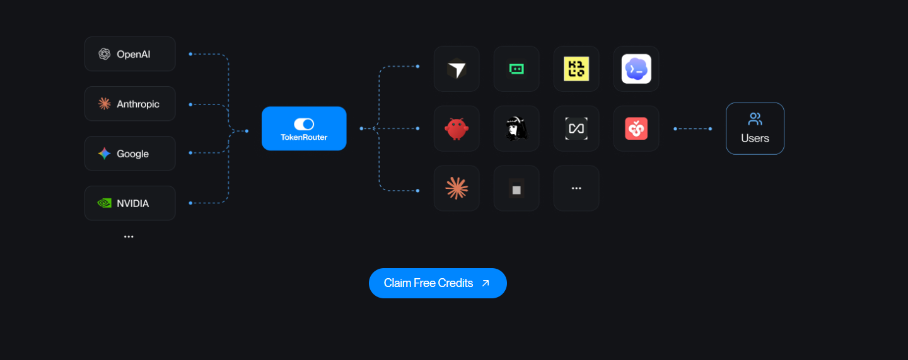

DeepSeek is free on TokenRouter this Thanksgiving. The model `deepseek-v4.1-flash-1017` is live now, and every account can use it at no cost. It is our way of saying thanks this season.

## What is live on TokenRouter

The model ID is `deepseek-v4.1-flash-1017`. It is available on TokenRouter today, and every account gets it free, so there is nothing extra to unlock.

## Why we are doing it

Thanksgiving is a good moment to thank the people who use what we build. Thank you to everyone on TokenRouter. A free model for the holiday season is a small way to give something back.

## How to try it

1. Log in to your TokenRouter account.
2. Select `deepseek-v4.1-flash-1017` as the model.
3. Send your request the way you normally would.

If you already route requests through TokenRouter, you only need to change the model name.

## Next step

Try the model while the Thanksgiving special is running, and let us know what you build with it.
