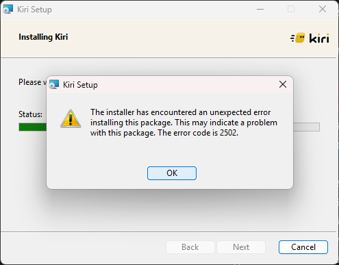
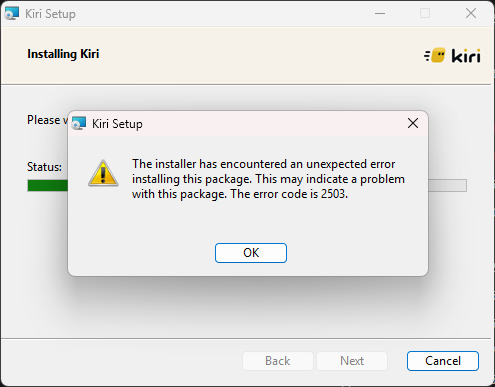

You start a setup, the progress bar moves for a few seconds, and then Windows stops it with "The installer has encountered an unexpected error installing this package." The last line gives a code: 2502 or 2503. I hit both while installing an app called Kiri.





The two codes come from the same problem. Windows Installer is asked to run something it has no permission to run, usually because the setup was not started with administrator rights or because it cannot write to `C:\Windows\Temp`. The fix is the same for both, and it works from PowerShell.

## 1. Open PowerShell as administrator

Right-click the Start button and choose **Terminal (Admin)** or **Windows PowerShell (Admin)**. Click **Yes** on the permission prompt. The title bar should say Administrator.

## 2. Run the installer from that window

Double-clicking an MSI file does not always carry your admin rights into the installer service. Starting it from the elevated window does. Swap in the path to your file:

```powershell
Start-Process msiexec.exe -ArgumentList '/i "C:\Users\You\Downloads\Installer.msi"' -Wait
```

If the program came as an EXE, run it with `Start-Process "C:\path\setup.exe" -Verb RunAs` instead. In my case this alone was enough. If yours still fails, go on.

## 3. Restart the Windows Installer service

A stuck service is the next most likely cause. Re-register it and start it again:

```powershell
msiexec /unregister
msiexec /regserver
Restart-Service msiserver
```

If `Restart-Service` says the service is not running, use `Start-Service msiserver`. Try the installer again.

## 4. Reset the Temp folder permissions

Error 2503 in particular appears when SYSTEM or Administrators lost access to the Windows Temp folder. This command gives both of them full control again, including everything inside it:

```powershell
icacls "C:\Windows\Temp" /grant "SYSTEM:(OI)(CI)F" "Administrators:(OI)(CI)F"
```

Do the same for the installer cache:

```powershell
icacls "C:\Windows\Installer" /grant "SYSTEM:(OI)(CI)F" "Administrators:(OI)(CI)F"
```

Run the setup again from the same admin window.

## Still failing?

Make the installer write a log and read the last lines before the error:

```powershell
msiexec /i "C:\Users\You\Downloads\Installer.msi" /L*v "$env:TEMP\install.log"
```

Search the log for `Return value 3`. The lines just above it name the file or folder Windows could not reach. If that path is on a drive that is disconnected or full, fix that first. Antivirus software can also block the same folders, so pause it briefly and try again.
