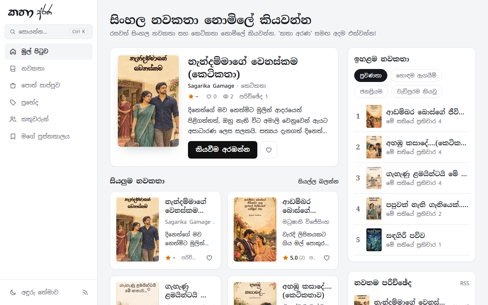
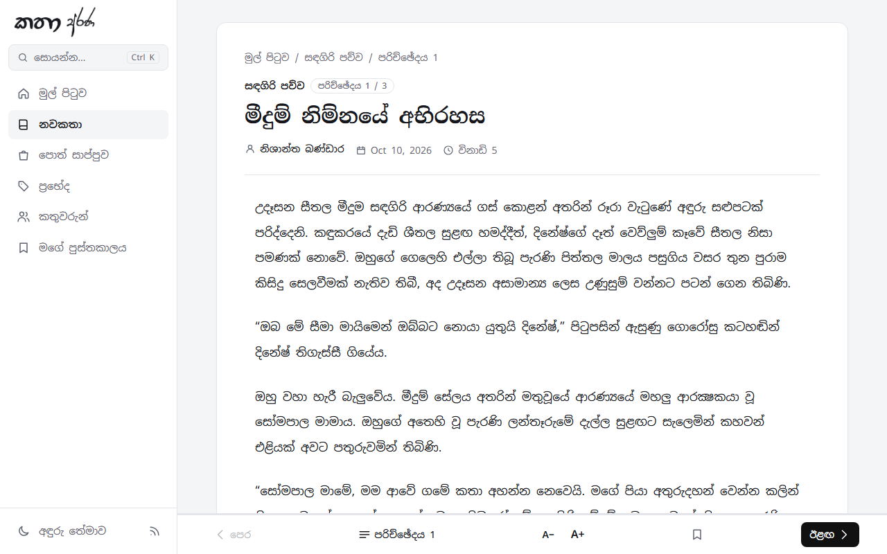

If you like reading Sinhala novels or short stories (කෙටිකතා) on your phone, there is now a place for them: [kathaarana.com](https://kathaarana.com/). It is free, and you do not need an account.

## What you can read

The library has novels and short stories, each split into chapters. Right now there are eight stories, from one-part short stories to a three-part novel like *සඳගිරි පව්ව*. Every story names its author, and when it first appeared somewhere else, it links to that original source (මුලාශ්‍රය).

You can browse by genre, look up everything one author has written, or use the search box in the side menu. The home page also lists the newest chapters, so you can see what was added last.

## Reading on your phone

Each chapter opens in a clean reader. Tap A+ or A- to change the text size, and pick a light, sepia or dark theme if you read at night. You can also switch between a plain Sinhala font and a book style font. The site remembers your choices in your browser.

A thin bar shows how far you are through the chapter. If you have to stop halfway, bookmark the chapter and come back to it later from "My library". The next chapter loads while you read, so turning the page is quick.

## Download a story as a PDF

Every story can be downloaded as a PDF with the cover, a title page, all the chapters and the author's name on each page. That is handy when you want to read offline, for example on a bus with weak signal.

## Rate it and share it

You can give a story stars or react with a heart. Those numbers feed the "top novels" list on the home page, so good stories rise to the top. There are share buttons for Facebook, WhatsApp and Messenger when you want to send a favourite to a friend.

## Who runs it

Kathaarana is a non-profit project built and run by [Infiax](https://infiax.com). The stories belong to their authors, and each page credits the writer. The code is public on GitHub, so you can see how it works or suggest a fix.

## Start reading

Open [kathaarana.com](https://kathaarana.com/), pick a story and read the first chapter. If you enjoy it, rate it and share it with someone who reads Sinhala.
