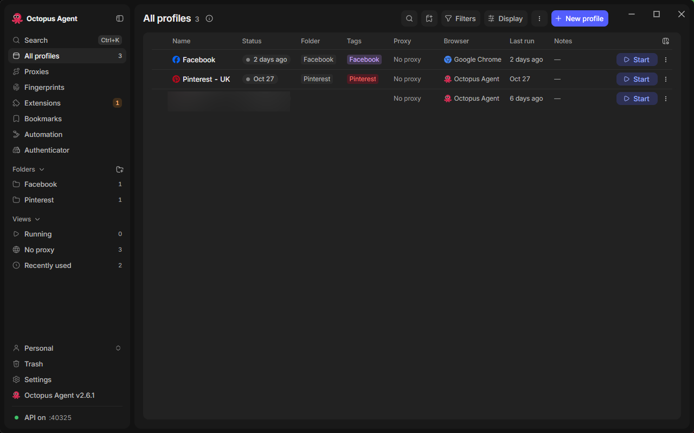
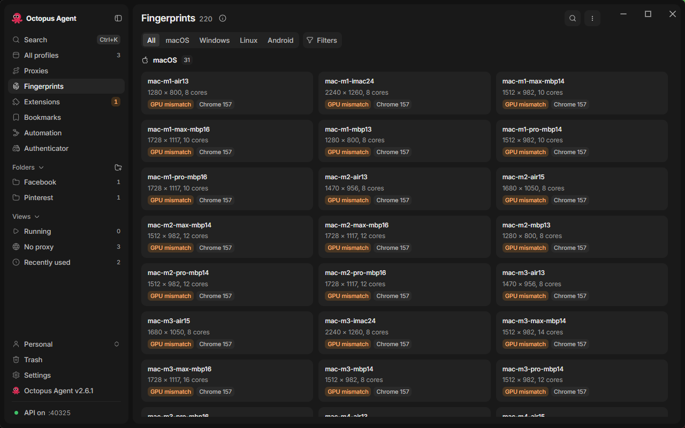
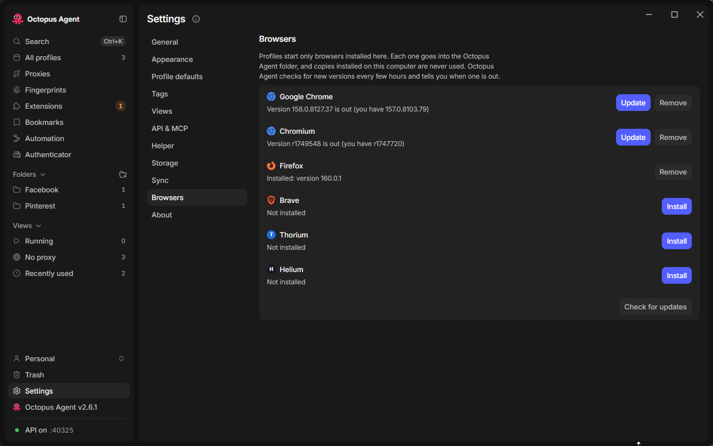

I built **Octopus Agent**, a free and open source anti detect web browser. It has no profile limit, no paid plan and no account to create. The code is on [GitHub](https://github.com/harindujayakody/octopus-agent) under the MIT licence, so you can read it, change it and run it yourself.

  <a id="oa-win" href="https://github.com/harindujayakody/octopus-agent/releases/download/v2.6.1/Octopus-Agent_2.6.1_x64-setup.exe" style="display:inline-flex;align-items:center;gap:8px;background:#e0245e;color:#fff;text-decoration:none;font-weight:600;padding:12px 20px;border-radius:10px">Download for Windows</a>
  <a id="oa-mac" href="https://github.com/harindujayakody/octopus-agent/releases/download/v2.6.1/Octopus-Agent_2.6.1_aarch64.dmg" style="display:inline-flex;align-items:center;gap:8px;background:#141414;color:#fff;text-decoration:none;font-weight:600;padding:12px 20px;border-radius:10px">Download for Mac (Apple Silicon)</a>
  v2.6.1 · MIT · <a href="https://github.com/harindujayakody/octopus-agent/releases/latest" rel="noopener">all downloads</a>

The Mac build is for Apple Silicon (M1 and newer). There is no Intel Mac build yet.

## What an anti detect web browser does

Websites do not only look at your cookies. They also read your screen size, graphics card, fonts, audio settings, time zone and a long list of other small details, and combine them into a fingerprint. If you run several accounts from one browser, those accounts share the same fingerprint, and a site can tell they come from one device.

An anti detect web browser gives each profile its own identity. Every profile has separate cookies and storage, its own device details and, if you want, its own proxy. To a website, each profile looks like a different person on a different computer.

## Free, with unlimited profiles

Most tools in this space charge by the number of profiles. Octopus Agent does not. You can create as many profiles as your computer can hold, and the only money you might spend is on proxies, because you bring your own. There is no store, no trial pop-up and no usage tracking.

Profiles can be sorted into folders, tagged, cloned, imported in bulk and backed up to a single file with their cookies and logins. You can restore a backup on another computer. Each profile also gets a cache cap of 2 GB, so a long-running profile does not eat your disk.

## How the fingerprint is changed

Most browser add-ons change a fingerprint by injecting JavaScript into the page, and sites can often spot that. Octopus Agent starts a patched Chromium engine that applies the values inside the browser itself. The same values show up in frames, workers, developer tools and headless sessions.

The app ships with 220 ready-made device profiles: Macs, Windows laptops and desktops, Linux machines and Android phones. Each one sets the screen, graphics, cores, memory and more, and the pieces stay consistent with each other. If you change the graphics card, the app adjusts the related values for you.

When you bind a proxy to a profile, Octopus Agent reads the proxy's country and sets the time zone, language and location to match. It supports SOCKS5 and HTTP proxies, and a WebRTC setting stops your real IP from leaking.

The project's README lists its results on the usual test pages, such as BrowserScan, Pixelscan and a reCAPTCHA v3 score check. Run those pages yourself on your own setup to see what you get.

## More than one browser

A profile does not have to use the patched engine. In Settings you can install Google Chrome, Chromium, Firefox, Brave, Thorium and Helium, and a profile keeps the browser you chose when you made it. Octopus Agent keeps its own copies up to date and tells you when a new version is out.

## For developers

Octopus Agent also works without the screen. It has a local HTTP API on your own machine, an MCP server so tools like Claude Desktop and Cursor can control profiles, and SDKs for Python, Node and Rust. There is a visual automation builder, synchronised windows that repeat your actions across profiles, and a self-hosted server if you want to share profiles with a team.

## Install it

Use the buttons above, or the [anti detect browser page](/free-tools/anti-detect-browser/) with the same downloads. The installers are not code signed yet, so your system may warn you the first time.

On Windows, SmartScreen may say "Windows protected your PC". Choose More info, then Run anyway. On a Mac, open System Settings, go to Privacy and Security, and choose Open Anyway next to the Octopus Agent message.

On first launch the app downloads the browser engine (about 150 MB) and the fingerprint library, so give it a minute.

## Use it responsibly

An anti detect browser is a privacy tool, and it can be misused. Use it for your own accounts, testing, research and automation that the sites you visit allow. Follow each site's rules and your local law.

## Credits and support

Octopus Agent is built on the open source [ShardBrowser](https://github.com/ProxyShard/ShardBrowser) launcher, and the patched Chromium engine comes from the ShardBrowser team. Thank you to them for publishing it under the MIT licence.

If Octopus Agent is useful to you, a star on the [GitHub repo](https://github.com/harindujayakody/octopus-agent) helps more people find it. Bug reports and ideas are welcome as issues there.
