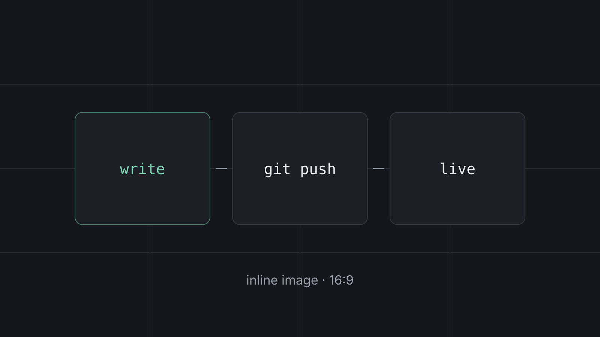

<!--
  The title above is already the page's <h1>.
  Don't start the body with "# Title". Start with an intro paragraph,
  then use ## (h2) for sections and ### (h3) for sub-sections.
-->

This first paragraph is the intro. Search engines and readers see it first, so say what the post is about in one or two sentences.

## Headings (h2)

Use `##` for each main section. They show up as clear section breaks and help Google understand the structure.

### Sub-headings (h3)

Use `###` inside a section. Avoid going deeper than h3, because long posts read better with fewer levels.

## Images

The cover image is set in front matter (`image:`), so it appears above the article and becomes the social card when the post is shared.

For an image inside the article, put the file in `src/content/blog/images/` and reference it relative to the post:



Images are shown in a 16:9 frame. Use 16:9 files (e.g. 1600×900) so nothing gets cropped. JPG, PNG and WebP are converted to WebP automatically.

## X (Twitter) embed

Copy the embed code from X (**⋯ → Embed post**), paste the `<blockquote>` part, **leave out** the `<script>` line, and replace blank lines inside it with `<br><br>`:

<blockquote class="twitter-tweet"><p lang="en" dir="ltr">Want a sneak peek at the Hermes Agent Mobile app?<br><br>It's still in Private Beta (for now...), but I recorded a quick tour of the app, including all the features, options, and capabilities</p>&mdash; tonbi (@tonbistudio) <a href="https://x.com/tonbistudio/status/2117332014877831657">November 2, 2026</a></blockquote>

At build time this becomes a card in the site theme: author, verified badge, text, a video or photo preview with "Watch on X", likes and replies. No X script is loaded.

## Text formatting

**Bold**, *italic*, `inline code`, and [a link](https://harindujayakody.com/projects/).

> A blockquote, for quoting someone or calling out a key point.

- Bulleted list item
- Another item
  - Nested item

1. Numbered step
2. Next step
3. Final step

## Code blocks

Add the language after the opening backticks for syntax highlighting:

```powershell
# Run as administrator
msiexec /i "C:\Path\To\Installer.msi"
```

```ts
const greet = (name: string) => `Hello, ${name}`;
```

## Tables

| Front matter field | Required | Example |
|---|---|---|
| `title` | yes | `"My post"` |
| `category` | no | `"Windows"` |
| `image` | no | `./images/cover.jpg` |

---

A horizontal rule (`---` on its own line) separates sections, as above. End with a short conclusion or next step.
