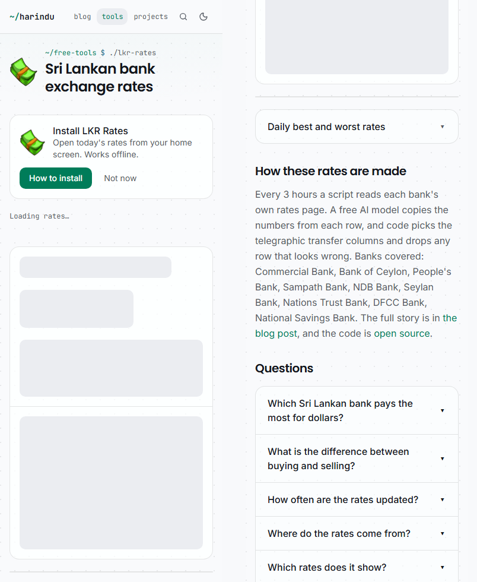

If you send money home or sell dollars in Sri Lanka, the rate you get depends on the bank. Each of the nine bank websites lays out its table differently, and I got tired of opening them one by one. So I built [LKR Rates](/free-tools/exchange-rates/). It shows nine banks side by side. It is free, and there is no account to make.

## What the page shows

The page opens on the selling rate and shows the buying rate next to it. Selling is what you pay the bank when you buy foreign currency. Buying is what the bank pays you in rupees when you hand some over. All rates are telegraphic transfer (TT) rates, in rupees for one unit of the currency.

USD, EUR, GBP and AED sit at the top. The other currencies are behind a button, so the screen stays short on a phone.

Under the currency buttons you see the bank with the best rate in large type, and how that rate moved over the range you pick. Below that are the lowest selling rate, the highest buying rate, the smallest gap between the two, and how many banks quote the currency. A table underneath ranks every bank, with the best one marked Best. If a bank's rates are more than 7 hours old, or its last update failed, it gets a Stale label.

## Rate history

Every refresh is saved. The chart shows the best rate over time for 1 day, 1 week, 1 month, 6 months or everything saved so far, and you can hover or touch the line to read the rate at that moment. The "Daily best and worst rates" section lists the best and worst selling and buying rate for each day, with the bank behind each one. The history starts on 2 November 2026, so the longer ranges fill in as the weeks pass.

## Install it on your phone

The page is also an app. On Android, Chrome shows an Install box on the page, and you tap Install. On an iPhone, open the page in Safari, tap Share and choose Add to Home Screen. After that it opens from your home screen like any other app, and the last rates you loaded stay readable when you have no signal.

Once you have installed it, the install box stops showing. If you tap Not now instead, it stays away for 30 days.

The app does not send notifications. You open it and see the rates from the latest 3 hour refresh.

## Where the numbers come from

Every 3 hours a script reads each bank's public rates page. A free AI model copies the numbers from each row. My code picks the TT columns and throws out rows that look wrong, such as a selling rate lower than the buying rate. Sampath publishes its rates as data, so that one skips the model.

The banks are Commercial Bank, Bank of Ceylon, People's Bank, Sampath Bank, NDB Bank, Seylan Bank, Nations Trust Bank, DFCC Bank and National Savings Bank. Pan Asia Banking and HNB are missing for now, because their pages need a real browser to show the rates.

The script runs on my own PC and publishes the rates as small data files on Cloudflare Pages. There is no server, and this site reads those files when you open the tool. A home connection can read banks that block data center servers. The catch is that if my PC stays off for a long time, the numbers get old and the Stale label shows up.

## Keep in mind

These are indicative rates read from the banks' websites. Banks change rates during the day, and the amount you transfer can change the offer. Check with your bank before you send or sell. The page shows TT rates only, not notes or cheques.

## Run your own copy

The code is on [GitHub](https://github.com/harindujayakody/exchange-rates-srilanka) under the MIT licence. The README explains the static setup I use. It also has a Docker version with a Telegram bot and an API, for anyone who wants a server. If a number looks wrong, open an issue with the bank and the currency.
