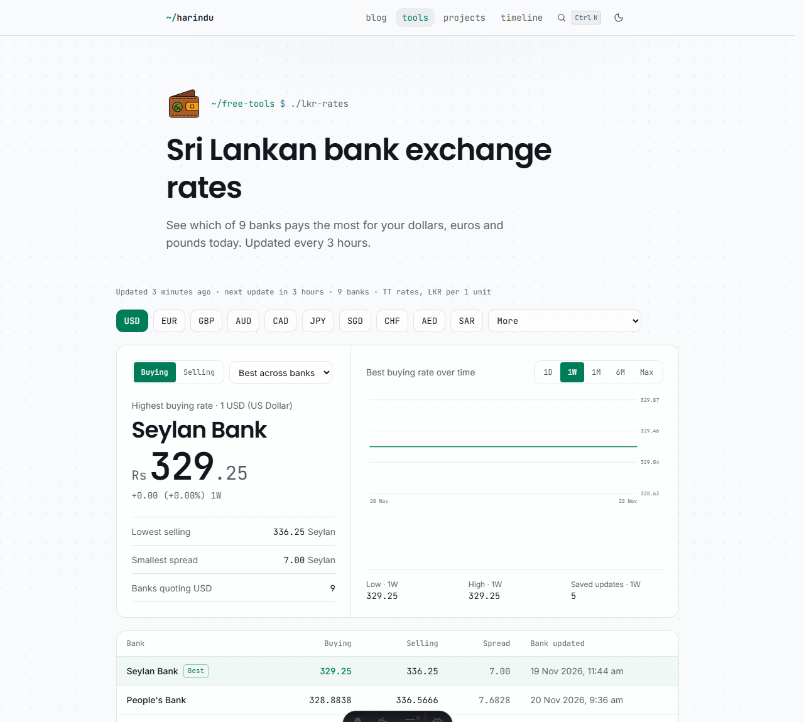

If you send money home or sell dollars in Sri Lanka, the rate you get depends a lot on the bank. Finding the best one means opening nine bank websites, and each lays out its table differently. So I built a page that does it for you: **[LKR Rates](/free-tools/exchange-rates/)**, and it runs right on this site. It is free, it needs no account, and the code is open source.

## What you see

Pick a currency and the page shows which bank pays the most for it today, in large type, with how the rate has moved over the last week. Under that you get the lowest selling rate, the smallest gap between buying and selling, and how many banks quote that currency. A table below ranks every bank for the rate type you picked.

A few things to know when you read it:

- **Buying** is what the bank pays you in rupees when you hand over foreign currency.
- **Selling** is what you pay the bank when you buy foreign currency from it.
- All rates are telegraphic transfer (TT) rates in LKR for one unit of the currency.

Below the main panel there is a list of the ten most used currencies, each with the bank that pays most and the bank that charges least. You can also search by bank or currency, for example "sampath" or "euro".

## The 9 banks

Commercial Bank, Bank of Ceylon, People's Bank, Sampath Bank, NDB Bank, Seylan Bank, Nations Trust Bank, DFCC Bank and National Savings Bank. Pan Asia Banking and HNB are not included yet, because their pages need a real browser to show the rates.

## Rate history

Every refresh is saved. The chart shows the best rate over time, and you can switch the range from one day to all time. The "Daily best and worst rates" section lists, for each day, the best and worst buying and selling rate with the bank behind it. The history starts on 2 November 2026, so the longer ranges fill up as the weeks pass.

## How it works

Every 3 hours a script reads each bank's public rates page. A free AI model copies the numbers from each row, and my code picks the right TT columns and rejects anything that looks wrong, such as a selling rate lower than the buying rate. The model only copies. The code decides. Sampath publishes its rates as data, so that one skips the model.

There is no server behind the page. The script runs on my own PC, writes the rates into small data files and publishes them on Cloudflare Pages. This site reads those files when you open the tool. Because it runs on a home connection, it can read banks that block data center servers. The flip side is that if my PC is off for a long time, the numbers get older. A bank whose rates are more than 7 hours old shows a "Stale" label.

## Things to keep in mind

These are indicative rates read from the banks' websites. Banks change rates during the day, and the amount you transfer can change the rate you are offered. Confirm with your bank before you transact. The page only shows TT rates, not notes or cheques.

## Run your own copy

The project is on [GitHub](https://github.com/harindujayakody/exchange-rates-srilanka) under the MIT licence. The README covers the static setup I use. It also has a Docker version with a Telegram bot and an API, if you would rather host it on a server.

If you spot a wrong number, open an issue there, with the bank and currency, and I will look at it.
