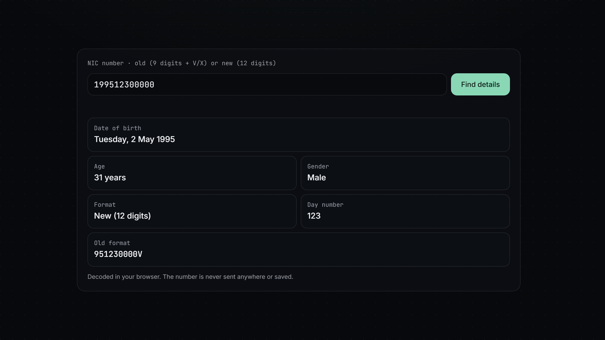
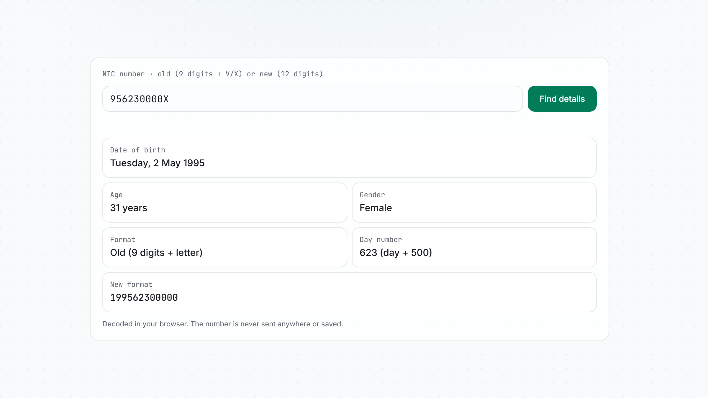

Every Sri Lankan National Identity Card number has the holder's birthday and gender built into it. You don't need a database to read them, only a bit of arithmetic. I wrote a small decoder for this years ago, found a bug in it, and fixed it. It now lives on this site at [/free-tools/sri-lanka-nic-decoder/](/free-tools/sri-lanka-nic-decoder/).

You can also use it right here. Type a NIC number into the box:

<div data-nic-decoder></div>

The number is decoded in your browser. It isn't sent to a server and isn't saved anywhere.

Every example number in this post is made up. Please don't paste real NIC numbers into comments, issues or chats, yours or anyone else's.

## What a NIC number tells you

A NIC number holds three facts about the person:

- The year they were born.
- The day of the year they were born on.
- Whether they're male or female.

The rest is a serial number and a check digit. Those don't reveal anything about the holder, so no decoder (mine included) can tell you a name, an address or a district from the number alone.

## The old format: 9 digits and a letter

Cards issued before 2016 use 9 digits followed by V or X. Take this made-up number:

`951230000V`

| Part | Digits | Meaning |
|---|---|---|
| Year | `95` | Born in 1995 |
| Day | `123` | Day 123 of the year |
| Serial | `000` | Serial number |
| Check digit | `0` | Check digit |
| Letter | `V` | V or X |

The year only has two digits, so every old number belongs to someone born in the 1900s.

## The new format: 12 digits

Since 1 January 2016 the Department for Registration of Persons issues 12-digit numbers with no letter. The same made-up person would have:

`199512300000`

| Part | Digits | Meaning |
|---|---|---|
| Year | `1995` | Born in 1995 |
| Day | `123` | Day 123 of the year |
| Serial | `0000` | Serial number, now four digits |
| Check digit | `0` | Check digit |

The year has four digits, which is how people born in 2000 and later get a number at all.



## How to find the date of birth from a NIC number

1. Read the year. In an old number add 19 to the front, so `95` is 1995. In a new number the first four digits are the year.
2. Read the next three digits. That's the day number.
3. If the day number is above 500, the holder is female. Take 500 away to get the real day. If it's 500 or below, the holder is male.
4. Count that many days into the year, using the table below.

Step 4 is where most decoders go wrong.

## February always has 29 days

The day number doesn't follow the real calendar. It counts every year as if it were a leap year, so February always has 29 days:

| Month | Day numbers |
|---|---|
| January | 1 to 31 |
| February | 32 to 60 |
| March | 61 to 91 |
| April | 92 to 121 |
| May | 122 to 152 |
| June | 153 to 182 |
| July | 183 to 213 |
| August | 214 to 244 |
| September | 245 to 274 |
| October | 275 to 305 |
| November | 306 to 335 |
| December | 336 to 366 |

So day 61 is always 1 March and day 123 is always 2 May, whatever the year. Day 60 is 29 February, and it can only appear for people born in a leap year.

For women the same table applies after taking away 500. A woman born on 2 May has 623 as her day number.



## Why some NIC decoders show the wrong birthday

Most programming languages make it easy to say "give me day 123 of 1995". In JavaScript that's `new Date(1995, 0, 123)`. The catch is that it uses the real calendar, and 1995 wasn't a leap year. February 1995 had 28 days, so day 123 lands on 3 May instead of 2 May.

My old version of this tool did exactly that. Anyone born in March or later in a non-leap year got a birthday one day late. People born in leap years like 1996 or 2000 saw the right date, which is why the bug was easy to miss. Testing with a 1996 number works fine, and testing with a 2009 number shows a date one day after the real one.

The fix is to stop asking the calendar and walk through the 29-day-February table instead. Here's the core of it:

```js
const NIC_MONTH_DAYS = [31, 29, 31, 30, 31, 30, 31, 31, 30, 31, 30, 31];

function dayToDate(dayNumber) {
  let day = dayNumber;
  for (let month = 0; month < 12; month++) {
    if (day <= NIC_MONTH_DAYS[month]) return { month: month + 1, day };
    day -= NIC_MONTH_DAYS[month];
  }
  return null; // above 366: not a valid NIC day
}
```

The decoder also rejects day 60 in a non-leap year, since 29 February 1995 never happened. A number like that is a typo or a fake.

If you've used another NIC decoder and its date doesn't match your birth certificate by one day, this is almost certainly why.

## How to convert an old NIC number to the new format

The conversion is mechanical:

1. Put `19` in front of the two-digit year.
2. Keep the three-digit day number.
3. Add a `0` in front of the three-digit serial.
4. Keep the check digit and drop the letter.

`951230000V` becomes `199512300000`. The decoder shows the converted number under the results.

Going the other way only works for people born before 2000 whose serial starts with 0. Anyone born in 2000 or later only has a new-format number.

## Is it safe to type your NIC number into a website?

A NIC number isn't a password, but combined with your name and birthday it's useful to someone trying to impersonate you. So I built this tool to keep the number on your device:

- The decoding is a few lines of JavaScript that run in your browser.
- Nothing is sent to a server, and nothing goes into cookies or local storage.
- The page's security policy blocks it from connecting to other websites, so even a bad script couldn't send the number out.

The code is open source, so you can read it yourself.

## What a NIC decoder can't do

It can't check that a card is genuine. A made-up number with a valid date decodes just as happily as a real one, as every example in this post shows. Only the Department for Registration of Persons can confirm that a NIC belongs to a real person.

It also can't tell you anything beyond the birth date and gender. A name or address isn't in the number, so a site that shows one got it from somewhere else.

## The source code

The original project is on GitHub at [harindujayakody/nic-information-finder](https://github.com/harindujayakody/nic-information-finder). The leap-year fix and tests are in there too. If it saved you a trip to a birth certificate, a star on the repo helps other people find it.
